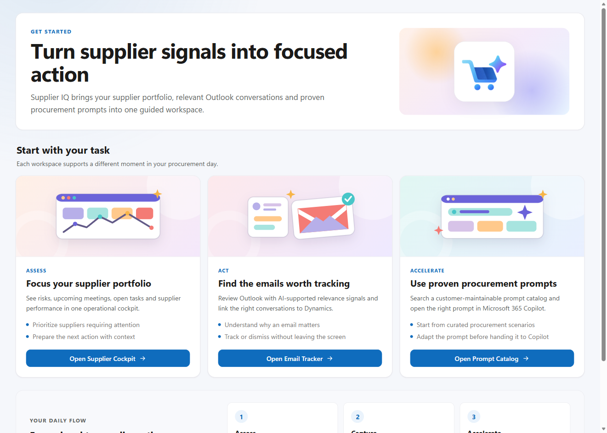
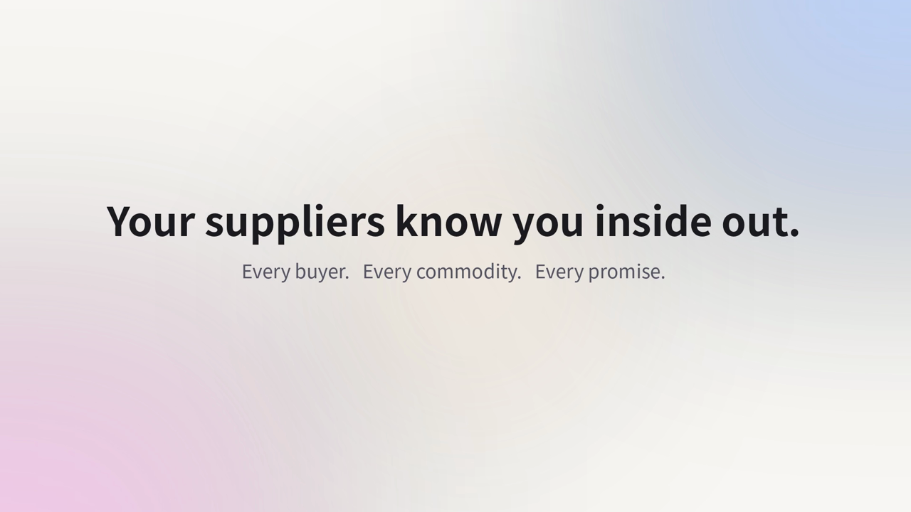

# Microsoft Supplier IQ documentation

  

Microsoft Supplier IQ is an AI-powered procurement and supplier management solution built with Dynamics 365, Microsoft Power Platform, and Microsoft 365 Copilot.

https://github.com/user-attachments/assets/585a8e33-94be-4874-8bd8-ccdab0558761

This repository contains the public product and deployment documentation. It provides the unmanaged solution package, a sample Prompt Catalog workbook, and a separately packaged Supplier IQ Cowork plugin.

## Documentation

### Get started

- [Prerequisites](docs/getting-started/prerequisites.md)
- [Installation](docs/getting-started/installation.md)
- [Cowork plugin installation and usage](docs/getting-started/cowork-plugin.md)

### Configuration

- [Supplier Account configuration](docs/configuration/supplier-accounts.md)
- [Prompt Catalog administration](docs/configuration/prompts.md)
- [Security roles and groups](docs/configuration/security.md)

### Architecture

- [Solution architecture](docs/architecture/overview.md)
- [Dataverse data model](docs/architecture/data-model.md)
- [Automation and integrations](docs/architecture/automation.md)

## Capabilities

- **Supplier Cockpit** - supplier portfolio, performance, risks, contacts, activities, tasks, and buyer collaboration
- **Email Tracker** - guided Outlook activity review and tracking to Dataverse
- **Prompt Catalog** - localized, Dataverse-managed procurement prompts with supplier selection and Microsoft 365 Copilot hand-off
- **Supplier Insights** - cached AI-generated activity summaries and supplier news
- **Cowork plugin 1.1.0** - supplier briefing, negotiation preparation, risk review and an Inbox Email Tracker, with explicitly confirmed Dynamics record updates

## Downloads

- [Microsoft Supplier IQ unmanaged solution 1.0.1.0](https://github.com/falcoostermann/Microsoft-Supplier-IQ-Docs/releases/download/solution-v1.0.1.0/MicrosoftSupplierIQ_1_0_1_0_unmanaged.zip) - [release notes](https://github.com/falcoostermann/Microsoft-Supplier-IQ-Docs/releases/tag/solution-v1.0.1.0) and [installation](docs/getting-started/installation.md#2-import-the-solution)
- [Sample Prompt Catalog workbook](https://github.com/falcoostermann/Microsoft-Supplier-IQ-Docs/releases/download/solution-v1.0.1.0/Supplier-IQ-Standard-Prompts.xlsx) - [release notes](https://github.com/falcoostermann/Microsoft-Supplier-IQ-Docs/releases/tag/solution-v1.0.1.0) and [import instructions](docs/getting-started/installation.md#6-seed-the-prompt-catalog)
- [Supplier IQ Cowork plugin 1.1.0](https://github.com/falcoostermann/Microsoft-Supplier-IQ-Docs/releases/download/cowork-v1.1.0/MicrosoftSupplierIQ_Cowork_1_1_0.zip) - [release notes](https://github.com/falcoostermann/Microsoft-Supplier-IQ-Docs/releases/tag/cowork-v1.1.0) and [installation](docs/getting-started/cowork-plugin.md)

The downloadable solution is an unmanaged development and pilot baseline. Create a managed release and complete environment-specific hardening before a production rollout.

The Cowork ZIP is a Microsoft 365 app package, not a Dataverse solution. It requires existing authorized Microsoft connections and target-tenant acceptance testing; it does not provision an MCP server or grant data permissions.

https://github.com/user-attachments/assets/585a8e33-94be-4874-8bd8-ccdab0558761

# Microsoft Supplier IQ documentation

  

Microsoft Supplier IQ is an AI-powered procurement and supplier management solution built with Dynamics 365, Microsoft Power Platform, and Microsoft 365 Copilot.

  
   
  <strong><a href="https://github.com/falcoostermann/Microsoft-Supplier-IQ-Docs/releases/download/solution-v1.0.1.0/Microsoft-Supplier-IQ-Overview.mp4">Watch the 90-second Microsoft Supplier IQ overview</a></strong>

This repository contains the public product and deployment documentation. It provides the unmanaged solution package, a sample Prompt Catalog workbook, and a separately packaged Supplier IQ Cowork plugin.

## Documentation

### Get started

- [Prerequisites](docs/getting-started/prerequisites.md)
- [Installation](docs/getting-started/installation.md)
- [Cowork plugin installation and usage](docs/getting-started/cowork-plugin.md)

### Configuration

- [Supplier Account configuration](docs/configuration/supplier-accounts.md)
- [Prompt Catalog administration](docs/configuration/prompts.md)
- [Security roles and groups](docs/configuration/security.md)

### Architecture

- [Solution architecture](docs/architecture/overview.md)
- [Dataverse data model](docs/architecture/data-model.md)
- [Automation and integrations](docs/architecture/automation.md)

## Capabilities

- **Supplier Cockpit** - supplier portfolio, performance, risks, contacts, activities, tasks, and buyer collaboration
- **Email Tracker** - guided Outlook activity review and tracking to Dataverse
- **Prompt Catalog** - localized, Dataverse-managed procurement prompts with supplier selection and Microsoft 365 Copilot hand-off
- **Supplier Insights** - cached AI-generated activity summaries and supplier news
- **Cowork plugin 1.1.0** - supplier briefing, negotiation preparation, risk review and an Inbox Email Tracker, with explicitly confirmed Dynamics record updates

## Downloads

- [Microsoft Supplier IQ unmanaged solution 1.0.1.0](https://github.com/falcoostermann/Microsoft-Supplier-IQ-Docs/releases/download/solution-v1.0.1.0/MicrosoftSupplierIQ_1_0_1_0_unmanaged.zip) - [release notes](https://github.com/falcoostermann/Microsoft-Supplier-IQ-Docs/releases/tag/solution-v1.0.1.0) and [installation](docs/getting-started/installation.md#2-import-the-solution)
- [Sample Prompt Catalog workbook](https://github.com/falcoostermann/Microsoft-Supplier-IQ-Docs/releases/download/solution-v1.0.1.0/Supplier-IQ-Standard-Prompts.xlsx) - [release notes](https://github.com/falcoostermann/Microsoft-Supplier-IQ-Docs/releases/tag/solution-v1.0.1.0) and [import instructions](docs/getting-started/installation.md#6-seed-the-prompt-catalog)
- [Supplier IQ Cowork plugin 1.1.0](https://github.com/falcoostermann/Microsoft-Supplier-IQ-Docs/releases/download/cowork-v1.1.0/MicrosoftSupplierIQ_Cowork_1_1_0.zip) - [release notes](https://github.com/falcoostermann/Microsoft-Supplier-IQ-Docs/releases/tag/cowork-v1.1.0) and [installation](docs/getting-started/cowork-plugin.md)

The downloadable solution is an unmanaged development and pilot baseline. Create a managed release and complete environment-specific hardening before a production rollout.

The Cowork ZIP is a Microsoft 365 app package, not a Dataverse solution. It requires existing authorized Microsoft connections and target-tenant acceptance testing; it does not provision an MCP server or grant data permissions.
