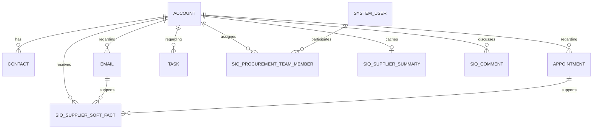

# Dataverse data model

Supplier IQ extends standard Dynamics 365 tables and adds focused custom tables for procurement collaboration, AI caching, and configuration.

## Standard tables

| Table | Use in Supplier IQ |
|---|---|
| Account | Supplier master, performance attributes, ownership, forms, and supplier portfolio |
| Contact | Supplier contacts, commodities, and Outlook tracking targets |
| Email | Tracked Outlook email activity |
| Appointment | Supplier meetings and activity context |
| Task | Procurement actions, due dates, and priority |
| System User | Buyer and specialist assignment |
| Connection | Supporting relationship and commodity information |

## Custom tables

### Supplier IQ Procurement Team Member (`siq_procurementteammember`)

Assigns a Dataverse user to a supplier and commodity. These assignments extend the Supplier Cockpit beyond Accounts owned directly by the current user.

Important columns:

- `siq_benutzer`
- `siq_lieferant`
- `siq_commodity`
- `siq_name`

### Supplier IQ Supplier Soft Fact (`siq_suppliersoftfact`)

Stores qualitative supplier observations derived from buyer input, emails, or meetings.

Important columns:

- `siq_supplier`
- `siq_detailnote`
- `siq_eventdate`
- `siq_sentiment`
- `siq_klassifizierungmc`
- `siq_linkedemail`
- `siq_linkedappointment`

### Supplier IQ Supplier Summary (`siq_suppliersummary`)

Stores cached AI-generated supplier intelligence and refresh state.

Important columns:

- `siq_AccountId`
- `siq_updates`
- `siq_news`
- `siq_ActivitySummaryStatus`
- `siq_ActivitySummaryGeneratedOn`
- `siq_ActivitySummaryRefreshRequested`
- `siq_ActivitySummaryError`
- `siq_SupplierNewsStatus`
- `siq_SupplierNewsGeneratedOn`
- `siq_SupplierNewsRefreshRequested`
- `siq_SupplierNewsError`

### Supplier IQ Comment (`siq_comment`)

Stores supplier-specific buyer collaboration notes.

Important columns:

- `siq_firma`
- `siq_commenttext`
- `siq_name`

### Supplier IQ Dismissed Email (`siq_dismissedemail`)

Stores Outlook activity IDs dismissed by a user so the Email Tracker does not repeatedly recommend them.

Important columns:

- `siq_activityid`
- `siq_name`

### Supplier IQ Prompt (`siq_prompt`)

Stores localized Prompt Catalog entries. The table is organization-owned and deliberately flat so administrators can use native Excel import without resolving lookups or numeric Choice values.

Important columns:

- `siq_title`
- `siq_promptcode`
- `siq_languagecode`
- `siq_description`
- `siq_prompttext`
- `siq_agent`
- `siq_agentid`
- `siq_category`
- `siq_tags`
- `siq_source`
- `siq_sortorder`
- `siq_enabled`

`siq_promptcode` and `siq_languagecode` form an alternate key.

## Account extensions

The standard Account table includes:

| Column | Purpose |
|---|---|
| `siq_issupplier` | Identifies Accounts that Supplier IQ may show as suppliers |
| `siq_anzahleskalationen` | Number of escalations |
| `siq_liefertreue` | Delivery performance |
| `siq_reklamationsrate` | Complaint rate |
| `siq_keytechnologien` | Key technologies |
| `siq_socialrating` | Supplier social rating |

## Relationships

## Choices

- `siq_classification`
- `siq_commodities`
- `siq_keytechnologien`
- `siq_sentiment`
- `siq_socialrating`
