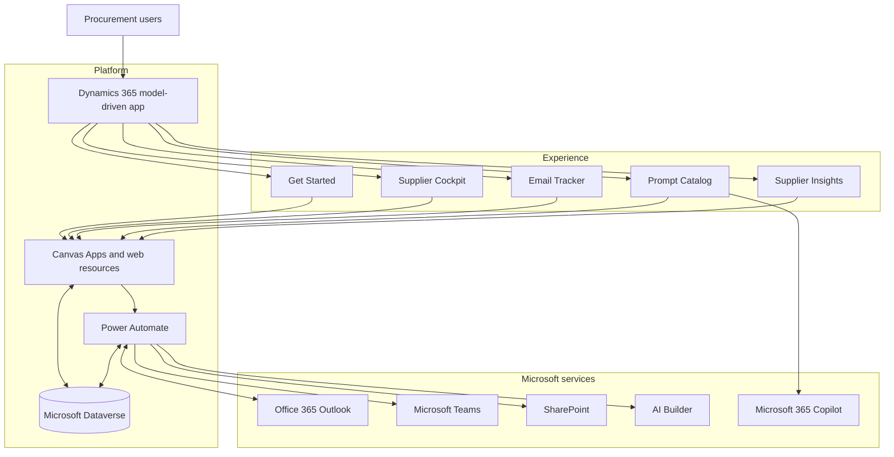

# Solution architecture

Microsoft Supplier IQ uses a Dynamics 365 model-driven app as the navigation and security shell. Specialized experiences use Power Apps and web resources, while Power Automate coordinates Dataverse, Outlook, Teams, SharePoint, AI Builder, and Microsoft 365 Copilot.

## Experience layer

- **Get Started** provides a localized entry point and navigation to the main workspaces.
- **Supplier Cockpit** combines supplier portfolio, performance, contacts, tasks, meetings, risks, and buyer collaboration.
- **Email Tracker** reviews Outlook activity and lets the user confirm the Dataverse Account or Contact before tracking.
- **Prompt Catalog** loads localized prompts from Dataverse and prepares them for the configured Microsoft 365 Copilot agent.
- **Supplier Insights** displays cached activity summaries and supplier news on the Account form.

## Application layer

- model-driven app: `siq_MicrosoftSupplierIQ`
- Canvas Apps for Outlook tracking and interactive AI operations
- HTML, JavaScript, CSS, image, and theme web resources
- supported client APIs such as `Xrm.WebApi`, `Xrm.Navigation`, and the Microsoft 365 Copilot panel APIs

## Automation and AI layer

- Power Apps-triggered flows for interactive user operations
- Dataverse row-change triggers for cached supplier intelligence
- scheduled Teams notifications
- AI Builder prompts for scoring, summaries, news, and document generation
- user-reviewed prompt hand-off to Microsoft 365 Copilot

## Data and integration layer

- Dataverse is the system of record.
- Outlook provides the invoking user's mailbox and calendar context.
- Teams delivers proactive reminders.
- SharePoint stores generated presentation documents.

## Identity boundaries

- Outlook actions use the invoking user's personal connection where required.
- Interactive Dataverse actions can run in the invoking user's context.
- Background generation uses configured service connections.
- Users review and confirm the target record before Outlook activity is written to Dataverse.

## Supplier Insights cache

Supplier Insights reads the latest `siq_suppliersummary` row immediately and keeps cached content visible while refreshes run asynchronously.

1. The Account form requests the current cache.
2. Content older than the configured threshold is marked for refresh.
3. A Dataverse trigger starts the relevant flow.
4. The flow writes `Generating`, calls AI Builder, and writes `Ready` or `Error`.
5. The web resource polls for completion.

For production, add concurrency controls, retry and backoff policies, stale-request recovery, monitoring, and operational alerting.
