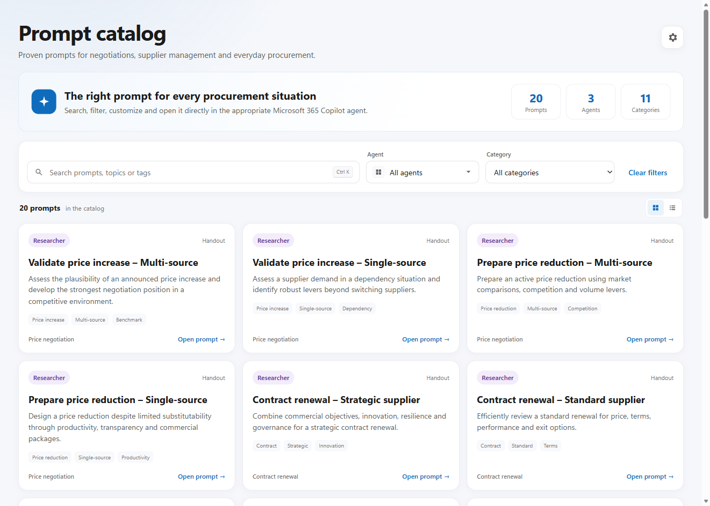
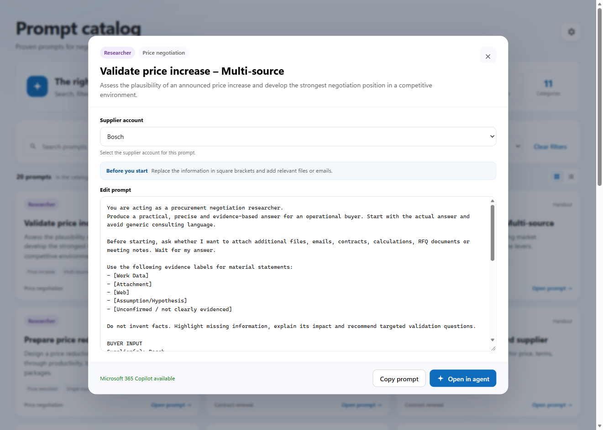

# Prompt Catalog

Store reusable, localized procurement prompts in the `siq_prompt` Dataverse table.



<div class="siq-rule" markdown>
**Enabled prompt** + **current user language** → visible in the catalog
</div>

English is the fallback language. **Prompt Code + Language Code** must be unique; **Sort Order** controls placement.

## Prompt columns

| Purpose | Logical name | Use |
|---|---|---|
| Identity | `siq_promptcode`, `siq_languagecode` | Stable code plus `en` or `de` |
| Card | `siq_title`, `siq_description` | Short, scannable copy |
| Content | `siq_prompttext` | Full editable prompt |
| Routing | `siq_agent`, `siq_agentid` | Display name and optional environment ID |
| Discovery | `siq_category`, `siq_tags` | Category and semicolon-separated terms |
| Governance | `siq_source`, `siq_sortorder`, `siq_enabled` | Owner, order, and visibility |

## Create a prompt in Dataverse

Administrators select the settings icon and create a Supplier IQ Prompt row:

1. Reuse one stable **Prompt Code** across languages.
2. Create one row per **Language Code** (`en` or `de`).
3. Add concise card copy and the full prompt.
4. Set agent, category, tags, order, and **Enabled = Yes**.
5. Save and refresh the catalog.

## Supplier placeholder

Use the canonical supplier placeholder:

```text
[SUPPLIER NAME(S)]
```

The catalog replaces it with the selected Account name. Other placeholders remain editable; the canonical Dataverse row is never overwritten.



## Import the sample workbook

[Download sample prompts](https://github.com/falcoostermann/Microsoft-Supplier-IQ-Docs/releases/download/solution-v1.0.1.0/Supplier-IQ-Standard-Prompts.xlsx){ .siq-button }

Open **Tables > Supplier IQ Prompt > Import data from Excel**, upload the workbook, map the columns, and confirm the rows. Review environment-specific Agent IDs before import.

Use **Edit data in Excel** for ongoing bulk maintenance.

## Copilot hand-off

**Open in agent** prepares the prompt in Microsoft 365 Copilot without submitting it. The user reviews and sends it.
