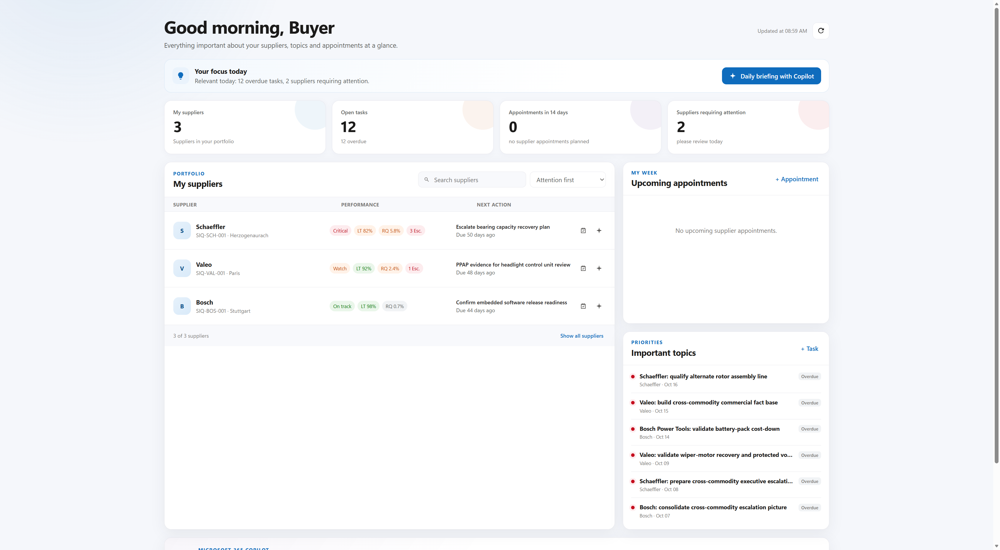

# Supplier accounts

Use the standard Dataverse Account table. One field activates the Supplier IQ experience:

<div class="siq-rule" markdown>
**Active Account** + **Is Supplier = Yes** → visible to Supplier IQ
</div>



## Where suppliers appear

| Experience | Rule |
|---|---|
| Prompt Catalog | Every readable, active supplier Account |
| Supplier Cockpit | Owned by the user or assigned through Procurement Team Membership |

Both lists are alphabetical. The cockpit currently returns the first 50 suppliers.

## Prompt behavior

The catalog inserts the selected Account name into:

```text
[SUPPLIER NAME(S)]
```

Users can edit the prepared prompt before copying it or opening Copilot. The canonical Dataverse prompt remains unchanged.

## Access

**Is Supplier** controls app behavior, not row security. Dataverse roles, teams, ownership, business units, and sharing still determine which Accounts a user can read.
