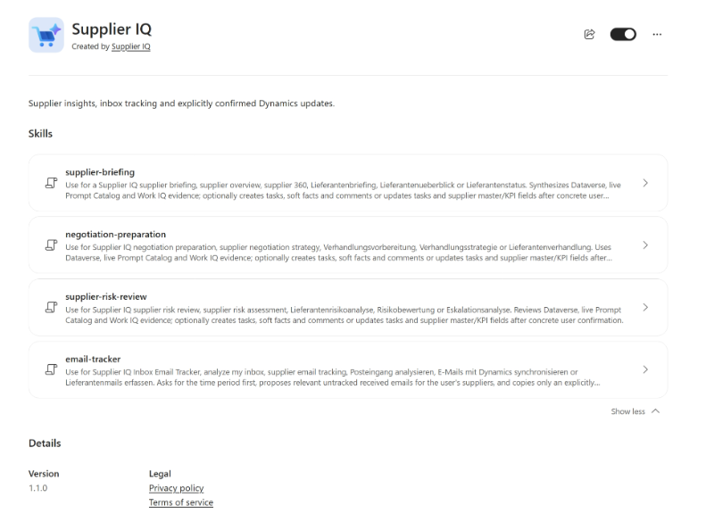

# Supplier IQ for Microsoft Copilot Cowork

The optional Supplier IQ Cowork plugin brings supplier analysis and controlled Dataverse updates into Microsoft Copilot Cowork. It is distributed separately from the Power Platform solution and uses the user's existing Microsoft data connection and permissions.

**Version 1.1.0 supports both reading and writing. Every write requires a concrete preview and your explicit confirmation.** No separate plugin setting is needed to enable the supported write workflows; the Microsoft connection must expose the operation and your account must have the necessary permissions.



| Property | Value |
|---|---|
| Current version | `1.1.0` |
| Package | [Download the Cowork plugin](https://github.com/falcoostermann/Microsoft-Supplier-IQ-Docs/releases/download/cowork-v1.1.0/MicrosoftSupplierIQ_Cowork_1_1_0.zip) |
| Included skills | 4 |
| Supported operations | Reading and writing, within existing connection capabilities and permissions |
| Write approval | Every write requires a preview and explicit user confirmation |

## Included skills

| Skill | Purpose |
|---|---|
| `supplier-briefing` | Builds a sourced overview of performance, risks, relationships and outstanding commitments |
| `negotiation-preparation` | Prepares an evidence-based negotiation brief, discussion plan and proposed trade-offs |
| `supplier-risk-review` | Reviews sourced risk evidence, uncertainties, contradictions and mitigation options |
| `email-tracker` | Reviews a selected Inbox period and proposes relevant, not-yet-tracked supplier emails for a confirmed one-time copy to Dataverse |

The skills respond in the user's language. They combine accessible Supplier IQ Dataverse records, applicable Prompt Catalog content and relevant Microsoft 365 context made available through Work IQ.

## How it works

```text
Supplier IQ Cowork plugin
  -> Existing Microsoft Dataverse/Dynamics or Business Applications connection
     -> Selected environment -> Supplier IQ and Prompt Catalog data
  -> Authorized Work IQ capabilities
     -> Relevant email, meetings, Teams, documents and people context
```

The package:

- does not install or host an MCP server;
- does not register a separate OAuth application;
- does not store a Dataverse environment URL;
- does not grant access beyond the signed-in user's existing permissions;
- does not install Supplier IQ tables, flows or applications.

Environment selection remains on the existing Microsoft connection. The actual read and write tools available to Cowork can vary by tenant, host and connector version. Test custom-table access and supported writes in the target tenant before broad rollout.

## Prerequisites

Before installing the plugin, confirm that:

1. The [Microsoft Supplier IQ solution](https://github.com/falcoostermann/Microsoft-Supplier-IQ-Docs/releases/download/solution-v1.0.0.0/MicrosoftSupplierIQ_1_0_0_0_unmanaged.zip) is installed in the target Dataverse environment.
2. The user can access the required Supplier IQ records and Prompt Catalog rows.
3. Microsoft Copilot Cowork and custom plugin packages are enabled for the tenant.
4. An existing Microsoft data connection is available in Cowork and can access the selected Dataverse environment.
5. The user has permission to the Microsoft 365 sources needed for the requested analysis.
6. Any intended Dataverse write operations are supported by the connection and permitted by the user's security roles.

Start with a non-production environment and safe test records.

## Install and activate

1. [Download `MicrosoftSupplierIQ_Cowork_1_1_0.zip`](https://github.com/falcoostermann/Microsoft-Supplier-IQ-Docs/releases/download/cowork-v1.1.0/MicrosoftSupplierIQ_Cowork_1_1_0.zip).
2. In the Cowork customization or plugin experience, upload the package using the supported custom plugin upload process.
3. If direct upload is unavailable, follow your tenant's Microsoft 365 app approval and publication process.
4. Enable the Supplier IQ plugin and the existing Microsoft data connection.
5. Sign in to the Microsoft connection and select the intended Dataverse environment on that connection.
6. Verify that all four Supplier IQ skills are visible.
7. Test a read-only supplier briefing before testing the Inbox period question, preview behavior and explicitly confirmed writes.

> **Do not import this package through Power Apps solution import.**
>
> The Cowork ZIP is a Microsoft 365 plugin package, not a Dataverse solution ZIP.

## Example requests

- "Prepare a sourced supplier briefing for Contoso covering the last quarter. State the environment, sources and data gaps."
- "Prepare my negotiation with Contoso about the next contract renewal. Use the relevant agreements and recent conversations, but create proposals only."
- "Review the evidence for supplier risks for Contoso this month. Separate facts, soft facts, contradictions and open questions."
- "Analyze my Inbox and suggest supplier-related emails that are not yet tracked in Dynamics. Ask me for the period first."
- "Show the final preview for the selected messages and attachments. Do not save anything yet."
- "Propose a supplier task and a soft fact. Show the exact values and ask before writing."

Replace the example supplier with an Account that the signed-in user is authorized to access.

## Reading and writing with explicit confirmation

The plugin is not limited to reading. You can request the supported Dataverse changes below without switching the plugin out of a read-only mode. An analysis request alone does not change records: before a write, the plugin must present a concrete preview with the target environment, record, relationships, fields and values. The user must explicitly confirm that specific preview.

Depending on the tools available in the tenant, eligible confirmed writes can include:

- supplier tasks;
- soft facts and comments;
- selected supplier, task or KPI field updates;
- incoming email copies and supported attachments.

The plugin revalidates the target and relevant source data before writing and reports the verified result. A changed preview, changed environment or stale source requires a new confirmation.

The plugin never sends email, changes Outlook read state or folders, deletes Dataverse records, schedules meetings, directly runs flows or refreshes Supplier Insight caches.

## Inbox Email Tracker

The Inbox Email Tracker is a guided one-time copy workflow, not continuous synchronization:

1. It asks for and confirms the reporting period, exact boundaries and timezone before reading mailbox items.
2. It scans the signed-in user's primary Inbox for that period.
3. It resolves "my suppliers" from active supplier Accounts owned by the current Dataverse user or assigned through Supplier IQ procurement-team membership.
4. It matches messages using verified contacts, participants, supplier identity and procurement relevance.
5. It compares the original Outlook Internet Message ID with Dataverse `email.messageid`. Already tracked messages are skipped.
6. It previews the proposed messages, supplier assignments, content and attachment handling.
7. It copies only the final selected batch after explicit confirmation and reads back the result.

Missing Internet Message IDs, an incomplete duplicate check or an ambiguous supplier assignment block copying until resolved. If an attachment is protected, unsupported, unavailable or too large, the user must choose whether to copy the email without it or skip the message before confirming.

Dataverse visibility can be broader than the user's private mailbox access. Review the final preview accordingly.

## Limitations

- Connector and Work IQ capabilities vary by tenant and may not expose every required custom-table or attachment operation.
- The package cannot grant Dataverse, Outlook, Teams, SharePoint or OneDrive permissions.
- It does not create a Microsoft connection or select an environment independently.
- It does not provide background or continuous email synchronization.
- A proposed change is not proof that the target connector can perform it. Unsupported writes remain proposals.
- Live target-tenant testing is required; static package validation cannot prove runtime authorization, duplicate prevention or connector interoperability.

## Troubleshooting

| Symptom | Recommended action |
|---|---|
| Supplier IQ skills are not visible | Confirm that version 1.1.0 was accepted, enabled and approved for the user |
| No Supplier IQ environment setting is shown | Select the environment on the existing Microsoft data connection |
| Standard Dataverse tables work, but `siq_*` tables do not | Verify the selected environment, Supplier IQ installation, connector coverage and table/field permissions |
| Microsoft 365 context is missing | Verify the relevant Cowork/Work IQ capability and the user's source permissions |
| Inbox results are incomplete | Confirm that the connection supports Inbox folder scope, received-time filtering and pagination |
| Emails cannot be copied | Verify Internet Message ID access, duplicate-query coverage, email parties, incoming state and attachment support |
| A write is denied | Keep the result as a proposal and correct the user's role, connection or connector capability; do not bypass the denial |
| Prompt Catalog content is unavailable | Verify access to enabled `siq_prompt` rows in the selected environment |

See [Downloads](../downloads.md) for package integrity information.
