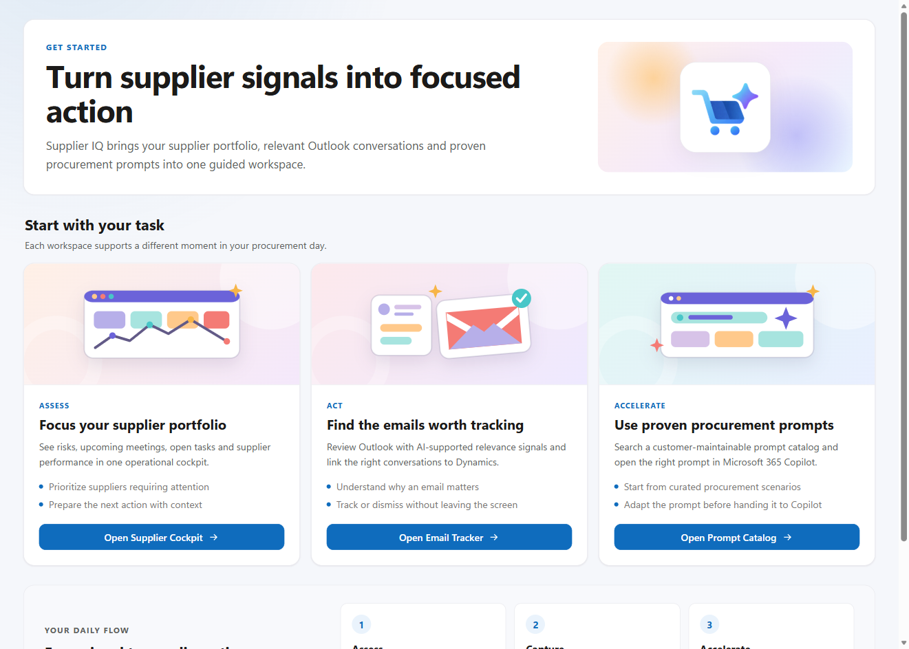

---
hide:
  - toc
  - navigation
classes:
  - siq-home
---

<section class="siq-hero">
  

    
    

      Microsoft Supplier IQ
      <h1>Turn supplier signals into action.</h1>
      
Profiles, Outlook signals, risks, actions, and proven prompts in one workspace.

      

        <a class="siq-button" href="getting-started/prerequisites/">Get started</a>
        <a class="siq-button siq-button--secondary" href="downloads/">Download Supplier IQ</a>
      

    

  

</section>

<section class="siq-section">
  See Supplier IQ in action
  <h2>One shared picture of every supplier</h2>
  
Watch the 90-second overview to see how Supplier IQ connects procurement context, communication, intelligence, and action.

  

    <video controls preload="metadata" poster="assets/images/supplier-iq-video-thumbnail.jpg">
      <source src="assets/videos/Microsoft-Supplier-IQ-Overview.mp4" type="video/mp4">
      Your browser does not support embedded video.
    </video>
  

</section>

<section class="siq-section">
  Explore the solution
  <h2>Everything buyers need, without scattered context</h2>
  

    <a class="siq-card" href="getting-started/prerequisites/">
      
        <svg viewBox="0 0 24 24"><path d="M12 2a7 7 0 0 0-4 12.74V18h8v-3.26A7 7 0 0 0 12 2Zm2 11.55-.75.44V16h-2.5v-2.01l-.75-.44A5 5 0 1 1 14 13.55ZM9 20h6v2H9v-2Z"/></svg>
      
      Get started
      <h3>Plan a pilot</h3>
      
Licensing, capacity, access, and onboarding.

    </a>
    <a class="siq-card" href="configuration/supplier-accounts/">
      
        <svg viewBox="0 0 24 24"><path d="M19.14 12.94a7.43 7.43 0 0 0 .05-.94 7.43 7.43 0 0 0-.05-.94l2.03-1.58-1.92-3.32-2.39.96a7.21 7.21 0 0 0-1.63-.94L14.87 3h-3.74l-.36 3.18c-.58.24-1.13.55-1.63.94l-2.39-.96-1.92 3.32 2.03 1.58A7.43 7.43 0 0 0 6.81 12c0 .32.02.63.05.94l-2.03 1.58 1.92 3.32 2.39-.96c.5.39 1.05.7 1.63.94l.36 3.18h3.74l.36-3.18c.58-.24 1.13-.55 1.63-.94l2.39.96 1.92-3.32-2.03-1.58ZM13 16a4 4 0 1 1 0-8 4 4 0 0 1 0 8Z"/></svg>
      
      Configure
      <h3>Shape the supplier experience</h3>
      
Suppliers, prompts, and access in a few clear steps.

    </a>
    <a class="siq-card" href="architecture/overview/">
      
        <svg viewBox="0 0 24 24"><path d="M11 2h2v5h-2V2Zm-7 9h5v2H4v-2Zm11 0h5v2h-5v-2Zm-4 6h2v5h-2v-5ZM8.46 6.05 9.88 7.46 6.34 11 4.93 9.59l3.53-3.54Zm7.08 0 3.53 3.54L17.66 11l-3.54-3.54 1.42-1.41ZM6.34 13l3.54 3.54-1.42 1.41-3.53-3.54L6.34 13Zm11.32 0 1.41 1.41-3.53 3.54-1.42-1.41L17.66 13ZM12 8a4 4 0 1 1 0 8 4 4 0 0 1 0-8Z"/></svg>
      
      Architecture
      <h3>Understand how it works</h3>
      
See how Microsoft cloud services connect.

    </a>
    <a class="siq-card" href="downloads/">
      
        <svg viewBox="0 0 24 24"><path d="M11 3h2v10.17l3.59-3.58L18 11l-6 6-6-6 1.41-1.41L11 13.17V3ZM5 19h14v2H5v-2Z"/></svg>
      
      Downloads
      <h3>Install the latest release</h3>
      
Solution, sample prompts, and Cowork plugin.

    </a>
  

</section>

<section class="siq-section">
  

    
    

      Guided experience
      <h2>Start with the task, not the technology</h2>
      
Supplier IQ gives buyers direct entry points for supplier focus, Outlook activity review, and proven procurement prompts.

      <a class="siq-button siq-button--secondary" href="getting-started/installation/">View installation guidance</a>
    

  

</section>
